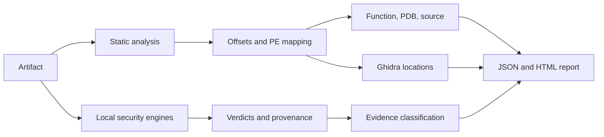

<div align="center">

# SigLens

### Evidence-driven Windows artifact analysis

Correlate static findings and local security-engine verdicts with the exact
file offsets, PE addresses, functions, symbols, and source locations that an
analyst can review.

[](https://github.com/St0rn/SigLens/actions/workflows/ci.yml)
[](https://www.python.org/)
[](#requirements)
[](LICENSE)

**Created by [St0rn / CybersecurIT](#project)**

[Overview](#overview) · [Capabilities](#capabilities) · [Quick start](#quick-start) · [Ghidra](#ghidra-workflow) · [Commands](#command-reference) · [Development](#development)

</div>

---

> [!NOTE]
> SigLens preserves the analyzed artifact. It distinguishes native offsets,
> exact YARA matches, inferred boundaries, and candidate regions so downstream
> decisions remain tied to the strength of the available evidence.

## Overview

SigLens is a local Windows analysis toolkit for artifact triage, false-positive
investigation, signature diagnostics, and detection engineering. It combines
PE inspection, YARA, AMSI, locally installed AV engines, symbol resolution, and
forensic reporting in one CLI and desktop workflow.

| Analyze | Correlate | Review | Report |
| :--- | :--- | :--- | :--- |
| PE structure, strings, entropy, IOCs, scripts | File offset → section → RVA → VA → function → PDB/source | Hex context, Ghidra bookmarks, engine provenance | Versioned JSON and standalone HTML |

SigLens uses two attribution models:

- **Binary artifacts:** exact YARA offsets, native engine offsets when exposed,
  fixed PE-region scans, and repeated prefix measurements for inferred
  detection boundaries.
- **Script artifacts:** a complete-buffer AMSI verdict combined with a separate
  structural map of functions and script blocks. Structural regions are review
  candidates, not asserted standalone signatures.



## Capabilities

### Artifact intelligence

- SHA-256, SHA-1, MD5, size, entropy, ASCII, and UTF-16LE strings.
- PE headers, sections, imports, exports, resources, overlay, and section hashes.
- IOC extraction for URLs, IPv4 addresses, domains, and Windows paths.
- Optional capa capability analysis.
- Binary comparison with changed-range reporting.

### Evidence correlation

- Exact YARA match offsets with PE and symbol correlation.
- File offset → section → RVA → VA conversion.
- x64 runtime-function boundaries from PE exception metadata.
- Local PDB symbol and source-line resolution when available.
- Local byte context with hexdump and printable strings.

### Security-engine analysis

- Microsoft Defender, ClamAV, and configurable local CLI adapters.
- Full-buffer Windows AMSI with normalized and raw result values.
- Fixed PE component and window scanning.
- Repeated prefix measurements with stability confidence and non-monotonic
  verdict detection.
- Explicit `CLEAN`, `DETECTED`, `UNKNOWN`, `UNAVAILABLE`, and `ERROR` states.

### Analyst experience

- Desktop interface with Dashboard, AV, AMSI, PE, Detection Map, Hex Viewer,
  Ghidra, and Reports views.
- CSV location export and hash-guarded Ghidra bookmark scripts.
- Cross-build evidence comparison for AV, AMSI, YARA, imports, and locations.
- SARIF 2.1.0 export for CI systems and compatible security platforms.
- Versioned `siglens-report/v1` JSON contract and standalone HTML reports.
- Atomic report writes and schema/semantic verification.
- Cooperative GUI cancellation between analysis stages.

## Quick start

### Requirements

- Windows 10, Windows 11, or Windows Server.
- PowerShell 5.1 or later.
- Python 3.11 or later for source and development installs.
- Internet access during dependency and optional ClamAV installation.

### Install from source

```powershell
git clone https://github.com/St0rn/SigLens.git
cd SigLens
.\scripts\Install.ps1 -Dev -AddToUserPath
```

The installer creates an isolated `.venv`, installs SigLens and its `siglens`
console command, detects local integrations, and installs or updates portable
ClamAV unless `-SkipAVInstall` is supplied. Licensed commercial products are
detected when present and are never installed silently.

If the current PowerShell policy blocks local scripts, apply the policy your
organization permits for this process before running the installer.

### Run an analysis

```powershell
siglens scan C:\Samples\sample.exe
```

```powershell
siglens scan C:\Samples\sample.exe `
  --yara .\rules `
  --symbol-path .\symbols `
  --iocs `
  --dissect `
  --capa `
  --amsi `
  --engines .\engines.json
```

Reports are written to `reports\` as JSON and HTML.

### Launch the desktop interface

```powershell
siglens gui
siglens gui C:\Samples\sample.exe
```

### Build the standalone executable

```powershell
.\scripts\Build.ps1
.\dist\SigLens.exe --help
```

The build includes engine configuration templates and the report schema under
`dist\`.

## Evidence model

Every Ghidra location carries a classification, confidence value when
available, and provenance.

| Classification | Meaning | Evidentiary strength |
| :--- | :--- | :--- |
| `EXACT_MATCH` | Exact offset emitted by YARA | Exact |
| `NATIVE_ENGINE_OFFSET` | Offset emitted by a configured engine adapter | Native to that engine |
| `INFERRED_BOUNDARY` | Reproducible transition bounded by prefix measurements | Experimental |
| `CANDIDATE_REGION` | Detected or structurally relevant region | Region-level |
| `CONTEXT_DEPENDENT` | Measurements do not support one responsible location | Indeterminate |

Prefix narrowing records repeated verdicts and controlled checkpoints. If the
same prefix produces conflicting results, or a shorter prefix is detected while
a longer prefix is clean, SigLens reports `CONTEXT_DEPENDENT` rather than a
single inferred boundary.

## Ghidra workflow

Generate an analysis report, verify it against the exact artifact, and export
review locations:

```powershell
siglens scan C:\Samples\sample.exe --yara .\rules --engines .\engines.json

siglens verify-report .\reports\sample.json `
  --artifact C:\Samples\sample.exe

siglens ghidra-offsets C:\Samples\sample.exe .\reports\sample.json `
  --output .\reports\sample-ghidra.csv `
  --script .\reports\ImportSigLens.py
```

The exporter verifies the artifact SHA-256 before using any location. The
generated script performs the same check inside Ghidra, resolves each RVA
against the current program image base, and creates a
`SigLens/<classification>` bookmark. Raw overlay offsets remain in the CSV
because they have no loaded memory address.

See [Ghidra location workflow](docs/ghidra-workflow.md) for import instructions
and interpretation guidance.

## Detection research workflow

Keep a baseline report for a known build, analyze the next build under the same
lab conditions, and compare the recorded evidence:

```powershell
siglens compare-reports .\reports\baseline.json .\reports\candidate.json `
  --output .\reports\evidence-diff.json
```

The comparison records engine verdict and signature transitions, AMSI changes,
added or removed YARA rules, PE import changes, and Ghidra-location counts by
classification. Results describe observed lab evidence; they do not label a
build as evasive or generate transformations. SigLens warns when tool versions,
engine sets, or AMSI coverage differ between the two reports.

Export the candidate evidence to SARIF 2.1.0 for ingestion by CI and analysis
platforms:

```powershell
siglens export-sarif .\reports\candidate.json `
  --output .\reports\candidate.sarif
```

SARIF results preserve byte offsets, confidence, RVA/VA data, engine signatures,
provenance, and deterministic fingerprints for result tracking.

## Command reference

| Command | Purpose |
| :--- | :--- |
| `scan` | Consolidated static, YARA, engine, IOC, PE, and report workflow |
| `multi-scan` | Full-file scans through configured local security engines |
| `amsi-scan` | Submit one complete file buffer through Windows AMSI |
| `script-analyze` | Full-buffer AMSI plus structural script diagnostics |
| `component-scan` | Scan fixed PE sections and the overlay |
| `narrow` | Bound a reproducible AV prefix-detection transition |
| `dissect` | Inspect PE sections, resources, hashes, entropy, and overlay |
| `inspect-offset` | Map an offset and display its local bytes and strings |
| `locate` | Correlate an offset with PE functions, PDBs, and source |
| `ghidra-offsets` | Export verified analyst locations and bookmark scripts |
| `verify-report` | Validate schema, hashes, ranges, and address consistency |
| `compare-reports` | Compare AV, AMSI, YARA, import, and location evidence |
| `export-sarif` | Export findings and provenance as SARIF 2.1.0 |
| `compare` | Compare two builds and report changed binary ranges |
| `path-test` | Diagnose Windows path and file-access behavior |
| `doctor` | Inspect runtime and integration availability |
| `gui` | Launch the desktop analyst interface |
| `about` | Display version and project attribution |

Run `siglens COMMAND --help` for command-specific options.

<details>
<summary><strong>Common focused workflows</strong></summary>

```powershell
# Map a known offset and inspect nearby content
siglens inspect-offset C:\Samples\sample.exe 0x005C0000 --preview-bytes 512

# Resolve the containing function and local symbols
siglens locate C:\Samples\sample.exe 0x18A20 --symbol-path .\symbols

# Inspect PE structure
siglens dissect C:\Samples\sample.exe

# Compare two builds
siglens compare .\old.exe .\new.exe

# Analyze a PowerShell script
siglens script-analyze C:\Samples\sample.ps1 --context-lines 5 --json

# Narrow a reproducible engine transition
siglens narrow C:\Samples\sample.exe --engines .\engines.json
```

</details>

## Engine configuration

Copy `engines.example.json` to a local configuration and enable only scanners
that are installed and licensed on the workstation.

```json
{
  "product": "SigLens",
  "engines": [
    {
      "name": "Example AV",
      "type": "cli",
      "enabled": true,
      "argv": ["C:\\AV\\scanner.exe", "--scan", "{file}"],
      "detected_exit_codes": [1],
      "clean_exit_codes": [0],
      "detect_regex": "(?i)(detected|infected)",
      "clean_regex": "(?i)(clean|no threat)",
      "signature_regex": "(?i)signature\\s*[:=]\\s*(?P<signature>[^\\r\\n]+)",
      "timeout": 300
    }
  ]
}
```

`{file}` is replaced with the normalized absolute path. CLI adapters are
started directly without a shell. Invalid regular expressions and timeout
values are rejected before a scanner process starts.

## Reports and integrity

SigLens JSON reports use the versioned `siglens-report/v1` contract. Reports
include tool version, UTC generation time, artifact hashes, evidence provenance,
limitations, and timing information when available.

```powershell
siglens verify-report .\reports\sample.json
siglens verify-report .\reports\sample.json --artifact C:\Samples\sample.exe
```

Artifact verification checks:

- report schema and timestamp format;
- duplicate JSON keys;
- SHA-256 and reported size;
- offset and range bounds;
- rendered hexadecimal values;
- `VA = image base + RVA` consistency.

Read the [report contract](docs/report-schema.md) or consume the machine-readable
[JSON Schema](schemas/siglens-report-v1.schema.json).

## Operational scope

- SigLens analyzes local artifacts and invokes only explicitly configured local
  security engines.
- Security products retain control of their own quarantine and remediation
  policies; analyze copies of samples when preservation matters.
- SigLens does not disable AV or EDR controls, patch AMSI, generate bypasses, or
  rewrite analyzed binaries.
- Inferred boundaries and candidate regions are diagnostic evidence. Confirm
  surrounding code, data references, control flow, and source mapping before a
  source-level change.
- Native AMSI, Defender, PowerShell integration, and the Windows executable are
  validated by the Windows CI jobs. Linux supports static analysis, tests, and
  development packaging but cannot reproduce those Windows-native integrations.

## Development

```powershell
.\scripts\Install.ps1 -Dev -SkipAVInstall
.\scripts\Test.ps1
.\scripts\Build.ps1
```

Or use the standard Python workflow:

```powershell
python -m venv .venv
.\.venv\Scripts\python.exe -m pip install -r requirements-dev.txt
.\.venv\Scripts\python.exe -m pip install --no-deps --no-build-isolation -e .
.\.venv\Scripts\python.exe -m pytest -q
```

CI runs Python 3.11 and 3.12 on Linux and Windows, builds the standalone bundle,
and executes dedicated Windows-native AMSI and Defender checks.

Maintenance commands:

```powershell
.\scripts\Install-AVs.ps1
.\scripts\Update-AVs.ps1
.\scripts\Update.ps1
.\scripts\Doctor.ps1
.\scripts\Uninstall.ps1
```

## Project

**SigLens 2.0** is created and maintained by **St0rn / CybersecurIT**.

```powershell
siglens about
```

Distributed under the [MIT License](LICENSE).
